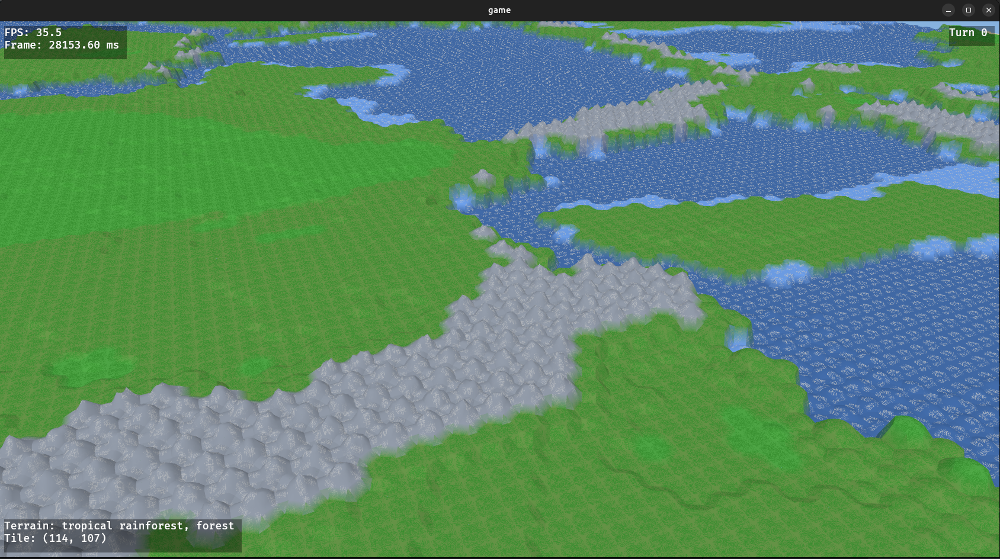
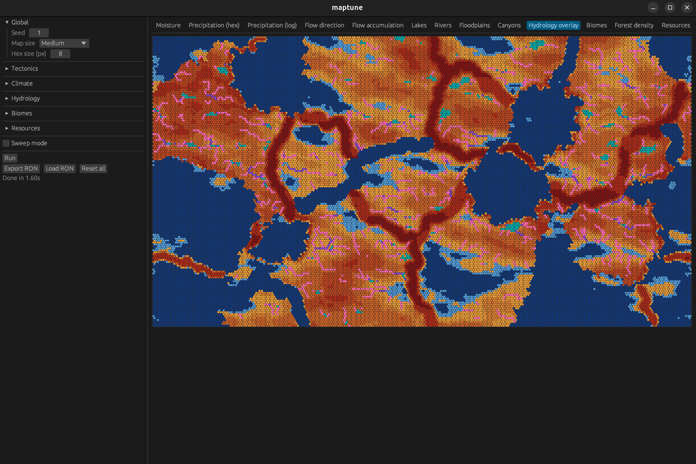

# Posterity (working title)

A turn-based 4X grand strategy game built in Rust with [Bevy](https://bevyengine.org/).
Every map is a procedurally generated world: plate tectonics shape the
continents, a climate simulation distributes rain, hydrology carves rivers
and lakes, and biomes and resources follow from all of it.



This is a personal learning project. Development is currently paused.

## Status

**Pre-alpha.** The world-generation pipeline is complete and tunable. The
game itself is a bare prototype: you can look at the map, move the starting
settler, found a city and end the turn. There is no economy, AI, combat or
win condition yet.

### What works today

**World generation** (`crates/worldgen`, no Bevy dependency, deterministic per seed)

| Stage | What it produces |
|---|---|
| Tectonics | Plates, boundary types, elevation, hills, mountain passes |
| Climate | Temperature, wind, moisture advection, precipitation |
| Hydrology | Flow direction and accumulation, lakes, tiered rivers, floodplains, canyons |
| Biomes | Biome classification and forest density from a data table |
| Resources | Resource placement by biome and terrain |
| Starting positions | Start tiles for players |

Five map sizes are available: `small`, `standard`, `medium`, `large`, `huge`.

**Game prototype** (`crates/game`)

- 3D hex terrain rendered in chunks: elevation tiers, cliffs, mountain
  peaks, water, textured terrain, forest and resource models.
- Orbit camera with pan, zoom and tilt.
- A settler spawned at a generated start position. You can select it,
  see where it can reach and move it, with movement points that reset each
  turn and one unit per tile.
- Founding a city with the settler.
- Ending the turn.
- All state changes go through a command queue
  (input → command → processor → event), so the simulation stays
  deterministic.
- Overlays for FPS, turn number and the terrain under the cursor.

## Running the game

You need stable Rust (edition 2024; CI uses 1.95.0). On Linux you also need
Bevy's system libraries (ALSA, udev, Wayland/X11, xkbcommon); the setup script
installs them on apt-based distros.

```bash
git clone https://github.com/kristoffersolsen/StrategyGame.git
cd StrategyGame
./scripts/setup-dev-env.sh        # toolchain, git hooks, system libraries

cargo run --release -p game
```

Use `--release`, because debug builds of Bevy are very slow. The world is
generated at startup, so the first frame takes a few seconds.

The map comes from `assets/worldgen/default_params.ron` (seed and size) with
the tuning preset `tools/maptest/presets/default.ron` applied on top. To play
a different world, edit those files. The game has no command-line options yet.

### Controls

| Input | Action |
|---|---|
| WASD / arrow keys | Pan camera |
| Mouse wheel | Zoom |
| Middle-mouse drag | Orbit and pan camera |
| Left-click | Select unit (click empty tile to deselect) |
| Right-click hold | Show tiles the selected unit can reach |
| Right-click release on a tile | Move there |
| `F` | Found a city with the selected settler |
| `Enter` / `Space` | End turn |

## Developer tools

Each tool lives in `tools/` and has its own README with full usage.

| Tool | Purpose | Run |
|---|---|---|
| [`maptune`](tools/maptune/README.md) | GUI for tuning world-generation parameters: live figures for every pipeline stage, parameter sweeps, RON export/import | `cargo run --release -p maptune` |
| [`maptest`](tools/maptest/README.md) | CLI for batch runs across many seeds and for single-parameter sweeps written to PNG | `cargo run --release -p maptest -- run` |
| [`mapdump`](tools/mapdump/src/main.rs) | CLI that dumps every stage of one seed to PNG | `cargo run --release -p mapdump -- --seed 42 --output tmp/mapdump` |
| [`maprender`](tools/maprender/README.md) | Bevy harness that opens the terrain renderer on any preset, seed or size, plus isolated rendering prototypes | `cargo run --release -p maprender` |
| [`mapbench`](tools/mapbench/README.md) | Rendering benchmark that drives the camera over a seed × size matrix and records frame times to JSON | `cargo run --release -p mapbench` |

`maptune` is the main tool for worldgen work. The screenshot shows the hydrology overlay for seed 1:



## Architecture

The repo is a Cargo workspace. The library crates do not depend on Bevy, so
world generation runs headless in tools and tests.

```text
crates/
  coords/    wrap-aware hex coordinate math (east-west wrap); no dependencies
  det_rng/   deterministic RNG primitives (seed derivation, ChaCha8)
  content/   content registry: string IDs to runtime handles
  worldgen/  generation pipeline: WorldParams -> WorldData
  game/      Bevy application
tools/       developer tools (above), depend on worldgen and/or game
```

Inside `game`, the `sim` module is the only code that mutates
game state. `input` turns player actions into commands. `rendering`
only reads state and reacts to events. `WorldData` is translated into the
game's own `StaticTerrain` at startup and then dropped, so no worldgen type
leaks into the runtime (ADR-0025).

The full description is in [architecture.md](documents/architecture/architecture.md).

## Documentation

| Document | Contents |
|---|---|
| [CONTRIBUTING.md](CONTRIBUTING.md) | Toolchain, build/test/lint commands, commit and branch conventions |
| [Architecture](documents/architecture/architecture.md) | Crate structure and dependencies |
| [Design overview](documents/design/overview.md) | Design pillars and cross-cutting design |
| [Design documents](documents/design/) | Worldgen, cities, combat, workers, resources, known issues |
| [ADRs](documents/adr/) | Architecture decision records |
| [Worldgen crate docs](documents/crates/worldgen/README.md) | Pipeline, API and parameter references |
| [Implementation plan](documents/planning/implementation_plan2.md) | Stages and current status |
| [Style guide](documents/guides/style-guide.md) / [Documentation guide](documents/guides/documentation-guide.md) | Code and documentation conventions |

## License

Not yet chosen. All rights reserved until a license is added.
